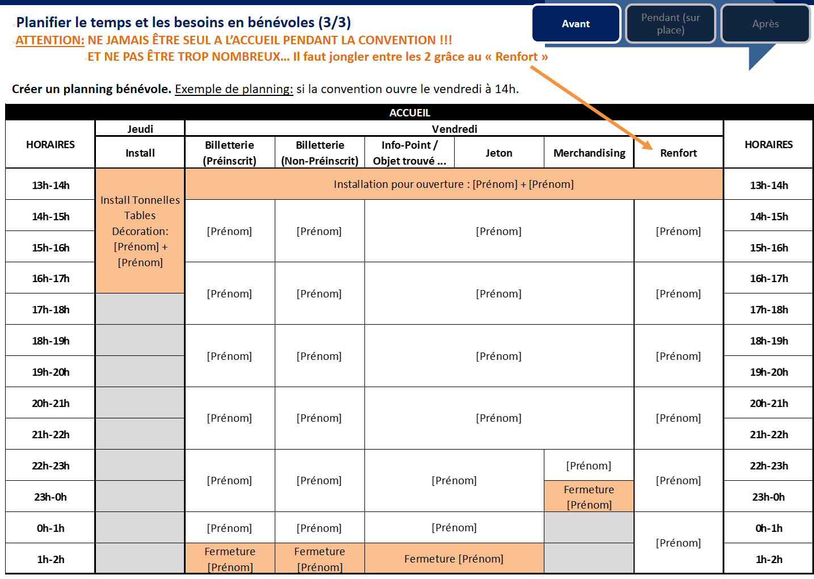

## L’organisation du pôle accueil en convention

### 1. Pourquoi avoir un accueil et pourquoi faire des pré-inscriptions ?

#### Pourquoi avoir un accueil en convention ? (vue d’ensemble) 

**L'accueil c'est (ou peut être):**
- le premier lieu de passage de la convention
- le lieu d'accueil des publics (conventionnistes, artistes, public extérieur, livreurs, presse et médias)
- le lieu d’information des publics et des festivaliers
- la billetterie qui délivre les passe-d’entrée du festival, les tickets des spectacles (vente ou pré-réservation) et les éventuelles adhésions associatives (membres ou organisateurs)
- un lieu de vente : jetons (si monnaie locale), merchandising (si t-shirt, éco-cup, goodies…)
- le lieu d'inscription des participants à la scène ouverte
- le lieu pour récupérer les objets-trouvés
- le lieu de point de rechargement électrique (téléphone, ordinateurs…)
- le lieu du tableau des covoiturages
- le lieu du tableau des workshops

**Remarque:** l’accueil doit être adapté selon la taille de la convention (fréquentation et durée), selon la programmation et selon les publics visés. Certains services peuvent être délocalisés de l’accueil (tableau workshops, point de rechargement, objets trouvés…).

#### Pourquoi faire des pré-inscriptions ? (vue d’ensemble)

**La pré-inscription c'est (ou peut être):**
- le lieu d’information des publics et des festivaliers en ligne
- un moyen de recrutement de bénévoles
- un moyen de communication
- un moyen de mieux estimer le nombre de participants (au fil du temps)
- un lieu de vente des places et donc un moyen d'augmenter la trésorerie avant la convention
- un lieu de vente de merchandising (si t-shirt, goodies…) et donc un moyen d'augmenter la trésorerie avant la convention
- un moyen de faire des inscriptions pour la scène ouverte

### 2. Qui s’occupe de l’accueil d’une convention et des pré-inscriptions?

#### Rôles et principales compétences utiles au pôle accueil

**Le(s) responsable(s) du pôle :**

Combien ? : Entre 1 et 3 personne(s) selon la taille et les besoins de la convention.

Compétences : 
- Être expérimenté.e (ou au min. très bien renseigné.e).
- Être organisé.e et rigoureux.
- Avoir de bonnes bases en calculs et en utilisation de tableur. 
- Avoir du temps pour mettre en place et faire le suivie du pôle.
- Maîtriser les outils de pré-inscriptions. 
- Savoir faire un planning-bénévole.
- Capacité d’écoute et de communication (sourire et empathie).
- Savoir résoudre des problèmes et gérer des conflits.
- Parler plusieurs langues.
- Connaître la majorité des informations concernant la convention.
- Être en interaction avec d’autres pôles (pôle orga générale + pôle bénévole + pôle artistique + pôle merchandising …).
- Savoir déléguer.

**Les « super-bénévoles » :**

Combien ? : Variable selon la taille et les besoins de la convention (fréquentation et durée).

Compétences :
- Connaitre l'intégralité des postes de l’accueil (fiche de poste).
- Gérer un planning bénévole-accueil.
- Manager l’équipe de l’accueil.
- Gérer de l’argent et une caisse.
- Gérer le public (écoute, info, file d’attente).
- Gérer la billetterie et les pré-inscriptions.
- Parler plusieurs langues
.
- Prise d'initiative.
- Savoir résoudre des problèmes et gérer des conflits.

**Les bénévoles :**

Combien ? : Variable selon la taille et les besoins de la convention (fréquentation et durée).

Compétences :
- Gérer le public (écoute, info, communication, gestion de la file d’attente).
- Parler plusieurs langues.
- Gérer de l’argent et une caisse.
- Capacité d’écoute et de communication (sourire et empathie).
- Gérer la billetterie et les pré-inscriptions.

**Remarque générale concernant les pré-inscriptions :**
Les pré-inscriptions se font plusieurs mois avant la convention. Leur mise en place est réalisée par un des responsables du pôle accueil.
Il est préférable de se mettre également en lien avec le pôle communication, pour mettre en place le système de pré-inscription.

## AVANT LA CONVENTION

### 3a. Où, comment et avec quoi faire une pré-inscription ?

**Gestion de la billetterie en pré-inscription :**
Mise en place opérationnelle des pré-inscriptions :
Où: La gestion des pré-inscriptions peut se faire sur internet.
Comment et avec quoi: 
- Le système de pré-réservation peut inclure le paiement direct en contrepartie de la réservation (chèque, virement, paiement électronique …). Dans ce cas, il faut que les organisateurs disposent d’un compte en banque et que les organisateurs envoient une confirmation de paiement aux personnes qui se préenregistre. Par exemple, les organisateurs peuvent utiliser la plateforme « Hello-Asso » à cette fin.
- Prévoir et communiquer l’ensemble des différentes tarifications selon le type de participants (gratuit, payant, tarif réduit, passe-convention, pass-jour, spectacles, animations…). Il est donc très conseillé d’avoir un budget prévisionnel, pour avoir ces informations !

**Le listing des pré-inscriptions:**
- Créer des listing qui prennent en compte: les conventionnistes, les orgas, les bénévoles, les artistes et les invité.e.s. 
- La liste des pré-inscriptions doit être exhaustive! 
Remarque: il peut être préférable d’avoir un listing différent pour chaque type de participant. Et il est impératif d’avoir une seule et même liste globale de participants !

**Trucs et astuces des pré-inscriptions :**
La pré-inscription est un espace pour communiquer des informations pertinentes du type: conditions d’hébergement, de restauration… mais aussi pour expliquer ce qui est interdit (avoir des animaux ou faire du feu en dehors des espaces dédiés…).
Vous pouvez également faire remplir un questionnaire au moment de la réservation, pour vous aider à recruter des bénévoles, ou obtenir certaines informations utiles au bon déroulement du festival (régime alimentaire ou autre).

**Trucs et astuces à faire avant pour gagner du temps sur place :**
Avoir une liste et des enveloppes nominatives qui seront prêtes pour toute personne préenregistrée (ou un pack standard) avec: le pass, les billets de spectacles, les éventuels tickets boisson et repas, 
le programme de la convention et le plan du site.
Si pré-enregistré.e, pour le t-shirt il/elle reçoit un ticket pour le récupérer au stand merchandising.
Cela peut être fait pour les artistes, les prestataires et les bénévoles (à voir avec le pôle bénévole et le pôle artiste).

### 3b. Où, comment et avec quoi faire un accueil ?

**Remarque générale concernant les bénévoles de l’accueil :**

Monter une équipe bénévole se fait plusieurs mois avant la convention. La mise en place est réalisé conjointement par 
le pôle accueil et le pôle bénévole pour définir les besoins et les capacités de ces ressources humaines.

**Planifier le temps et les besoins en bénévoles :**

Créer des fiches de poste. 
Chaque fiche doit comprendre les instructions de ce que doivent faire les bénévoles, comment communiquer entre les responsables de pôles et les bénévoles et toute autre information pertinente. Vous pouvez les mettre par écrit (disponible à l’accueil), mais vous devez également demander aux gens de transmettre ces informations aux volontaires suivants, par le biais d'une initiation rapide.

**Exemple de poste :**

« Billetterie Pré-inscription »: Nombre de personne: 1. Tâches à effectuer: Accueillir le public pré-inscrit, cocher le listing des entrées, leur donner un passe (ou une enveloppe avec tout (passes, tickets spectacle, programme, plan …)) et répondre à leurs questions. Compétences: parler plusieurs langues, avoir le sourire, connaître les principales informations sur la convention (indiqué sur la fiche de poste). 

« Billetterie des non-pré-inscription »: Nombre de personne: 1. Tâches à effectuer: Accueillir le public non-préinscrit en leur faisant remplir le listing des entrées, les encaisser du montant de l’entrée, leur donner un passe ou un ticket spectacle et répondre à leur questions. Compétences: parler plusieurs langues, avoir le sourire, connaître les principales informations sur la convention (indiqué sur la fiche de poste).

« Stand Merchandising »: Nombre de personne: 1. Tâches à effectuer: Renseigner sur les produits à vendre, encaisser de l’argent. Compétences: parler plusieurs langues, avoir le sourire, gérer une caisse et de l’argent, connaître les tarifs des produits à vendre, les tailles, couleurs …

« Jetons »: Nombre de personne: 1. Tâches à effectuer: Échanger des jetons (monnaie de la convention) contre de l’argent. Compétences: parler plusieurs langues, avoir le sourire, gérer une caisse et de l’argent.

« Info-point » Nombre de personne: 1. Tâches à effectuer: Répondre à toutes sortes de questions, transmettre des informations, gérer les objets trouvés, … Compétences: parler plusieurs langues, avoir le sourire, résoudre des problèmes.

« Renfort » Nombre de personne: 1. Tâches à effectuer: Être capable de faire n’importe quel poste de l’accueil. Compétences: celles de chaque poste détaillé juste à l'instant.

**Définir les horaires d'ouverture et de fermeture de l’accueil.**

Pour définir les horaires il faut prendre en considération: 

- La programmation (horaires d’ouverture publics pour spectacle, animation, concert…).
- Le nombre total de bénévoles et d’orgas que l’on peut allouer sur ces postes (en prenant en considération que les orgas ont d’autres fiches de postes qui les concerne. Attention donc à ne pas surcharger les tâches à effectuer). Ne gaspillez pas vos volontaires... il n'est pas bon d'avoir sept personnes assises derrière l'inscription pendant deux heures, elles ne peuvent pas aider le reste de la journée. Mais en même temps, il faut faire attention aux périodes de rush (ouverture de la convention, soirée spectacles…), car il faut que les bénévoles soient en nombre suffisant pour assurer l’ensemble des postes et tâches, avec une certaine fluidité et un certain confort.
- Il faut donc communiquer avec les responsables généraux, le pôle bénévoles (nombre et durée de bénévoles disponible), le pôle programmation (horaire d’ouverture stratégique), le pôle budget (catering) et le pôle merchandising (coût des t-shirts bénévoles) avant de définir les horaires de l’accueil, qui seront définies en fonction des besoins, des coûts et des capacités en ressources humaines.

**Créer un listing bénévole.**

Pour se faire, on peut se mettre en lien avec le pôle bénévole, qui pourra le cas échéant vous fournir ce listing.
Devrait apparaitre sur ce listing, au minimum : nom, prénom, e-mail et numéro de téléphone.

**Créer un planning bénévole.**

Ayez un calendrier avec les horaires précises à occuper pour chaque poste à pourvoir.
Exemple de planning:

**Informer les bénévole et garder le contact avec eux.**

- Une fois qu’on a le listing et les horaires d’ouverture (planning), il faut contacter les bénévoles, leurs donner des informations (dates, fiche de postes, gratifications bénévoles…), envoyer le planning (pour qu'ils puissent remplir les temps qui leur conviennent) et répondez à leurs questions. Remarque: voir la partie « Pré-inscription », pour décider si on met en place un questionnaire de recrutement bénévole en ligne.
Après réponse de leur part, informer les bénévoles en leur envoyant le planning avec leurs horaires pour valider avec eux et rester en contact.
- Si les bénévoles ont un pass, on peut prévoir de mettre au dos la liste des responsables de pôles avec le numéro de téléphone (ou talkie-walkie).
Remarque: Cette partie peut aussi être réalisée par le pôle bénévole.

**Planification de l’implantation et de l’aménagement: de l'espace, de la logistique et de la décoration :**

**Aménagement de l'espace.**

- Pour prévoir l’aménagement, il est utile d’avoir le plan du site et savoir à quel endroit et dans quelles conditions sera placé l’accueil. 
C’est un lieu stratégique. Il faut qu’il soit facilement accessible, avec une grande visibilité et climatiquement agréable : Au sec, à l'ombre, pas en courant d'air, chauffé si la convention se déroule en hiver...

- La taille de l’accueil devrait être proportionnelle à la convention.

- Exemple d’aménagement possible: Pour les grandes conventions, l’espace pour la billetterie devrait être séparé de celui des jetons et du merchandising (et les caisses sont séparées). Néanmoins, si l’ensemble de l’accueil constitue un seul et même block, il sera plus simple de le sécurisé pendant les moment de fermeture de l’accueil.

L’espace « billetterie » peut-être aménagé avec deux tables séparées : une pour le paiement à la journée, une pour les pré-inscriptions.

L’espace « jeton/merchandising/info-point/objets trouvé » peut-être aménagé avec une ou deux tables (selon le stand merchandising) pour la vente de T-shirts, la vente de jetons, les objets trouvé et les renseignements.

Pensez à des espaces de rangements pratiques (sous les tables dans des boites ou cartons séparés...).

**Logistique.**

Des toilettes à proximité sont utiles pour les bénévoles et pour le public. 
Des prises électriques pour le rechargement mobile, les lumières, bouilloires / grille-pain… 
Il faut bien penser à l'éclairage, prévoir des lampes pour les tables.

**Décoration et affichage.**

- Préparation des PLV, affiches, signalétiques, tarifs, merchandising.
Avoir des documents pour informer les jongleurs (imprimer le programme et le plan de la ville pour les commerces, gare, transport…)
- Une liste de prix pour les différentes passes.
- Imprimer les fiches de postes, les plastifier, et les scotcher sur les tables aux postes correspondants.
- Un tableau de workshop et d'autres informations. Ce tableau doit comprendre une carte sur laquelle sont indiqués les magasins, les points de vente, la nourriture et la bière. Un tableau d'affichage est également une bonne idée. Les orgas vous demandent souvent : "Quand un tel ou un tel arrive, tu peux lui dire que ...". Vous oublierez inévitablement. Faites-le leur écrire !

**Le top du top (mais pas nécessaire).**

- Un chill-out juste à côté de l’accueil (espace avec jeux/canapés...), permet un recrutement de bénévoles sur le pouce.
- Carte géographique des conventionnistes avec épingles/punaises…
- Calendrier des conventions à venir… avec carte de France, flyers, affiches…
- Gestion du flux : petits jeux pendants la file d'attente.
- Roulettes : Adhésion AFJ, Merchandising
- Expliquer les budgets de conventions = Food, artistes, installation, location... (avec une boîte à dons)
Tableau : A partir de là... (on peut payer les artistes, un happy-hour, des micros...) avec un curseur (magnétique).

**Sécurisation de l’accueil.**

Prévoir un grand espace sécurisé derrière le « bureau » pour les bénévoles, les papiers importants, les marchandises, les jetons, les objets trouvés... + un endroit où garder les grosses sommes d'argent.
Idéalement, il y aura un accès facile et sécurisé de l'arrière de l’accueil du site pour l'encaissement.
Prévoir d’évacuer l’argent de manière sécurisée et discrète pour qu’il n’y a pas trop d’argent à un moment donné (le premier soir par exemple). Le mieux est que l’argent quitte le site complètement.

**Fermeture de l’accueil.**

Lorsque l’accueil est fermé, il faut un moyen de sécuriser le stock, les laissez-passer, les billets, le merchandising...
Le responsable ferme l'accueil après le dernier vidage/comptage caisse.
Ce comptage caisse s'effectue à deux personnes avec documents de tenues de caisse à l'appuie, signé et rangé dans le classeur.

**Inventaire du matériel :**

**Papèterie.**

Stylos, feutres, scotch, gaffer ficelle, imprimante, ramette de papier, surligneurs, marqueurs, 
pinceaux, peinture, carton, pâte-à-fixe, punaises, agrafes, clous, marteau, pinces à linge, 
ciseaux, cutter, classeur, cahier d'ouverture et de fermeture des caisse, trombones......

**Support de communication interne.**

Liste: des responsables de pôles avec N° téléphone 
Fiche de poste
Talkie-Walkie

**Support de communication externe.**

Affiches, programme, plan, tarifs, tableau…

**Billetterie.**

- Listing: pré-inscription, orgas, bénévoles, artistes, invité.e.s.
- Liste des prix pour les différentes passes
- Tickets, passes, tampons, badges…

**Argent.**

- 2 caisses en métal qui se ferment avec trieur de pièces et billets.
- Enveloppes de transports, fiche de caisse/doc de tenue de caisse
- Fonds de caisse à prévoir entre 300€ et 1500€ (selon la taille de la convention) 
en pièces de 0.5€, 1€, 2€ et quelques billets de 5€.

**Jetons.**

Il faut définir si vous optez pour des jetons ou pour de la monnaie. 
Si vous utilisez des jetons, vous pouvez contacter l’AFJ pour en avoir à disposition (afj.jonglerie@gmail.com). 
Si vous utilisez des euros, il faut prévoir un fond de caisse
 
**Autres.**

- Boite pour objets trouvés, …
- Covid 19 : Gel hydro-alcoolique, masques, plaques en plexiglass...

## PENDANT LA CONVENTION

### 3. Où, comment et avec quoi faire un accueil ?

**Montage**

Déchargement et organisation de l'espace.
Prévoir d'arriver tôt

Vérification du matériel.
à l’aide d’un listing

Gestion et management de l’équipe-MONTAGE de l’accueil.
- Accueillir l’équipe-Montage. Présentez-vous, entre vous pour que tout le monde s’identifie. 
- Briefer et manager l’équipe-Montage. Expliquer les étapes du montage, à savoir: 
« Implantation et installation de l’espace » et « Installation de la décoration et de l’affichage ».

Implantation et installation de l’espace.
Ameublement, électricité...
L’espace « billetterie » peut-être aménagé avec deux tables séparées : une pour le paiement à la journée, une pour les pré-inscriptions.
L’espace « jeton/merchandising/info-point/objets trouvé » peut-être aménagé avec une ou deux tables (selon le stand merchandising) pour la vente de T-shirts, la vente de jetons, les objets trouvé et les renseignements.
Pensez à des espaces de rangements pratiques (sous les tables dans des boites ou cartons séparés...).

Installation de la décoration et de l’affichage.
- Installation des affiches, programmes, plans, signalétiques, tarifs, merchandising.
- Installation des fiches de postes, les plastifier, et les scotcher sur les tables aux postes correspondants.
- Installation du tableau de workshop et d'autres informations. Ce tableau doit comprendre une carte sur laquelle sont indiqués les magasins, les points de vente, la nourriture et la bière.

Réception des passes et du merchandising. A voir avec le pôle merchandising.

**Un peu avant l’ouverture de la convention**

Gestion et management de l’équipe-accueil – POSTES et PLANNING.
- Accueillir l’équipe-accueil. Présentez-vous, entre vous pour que tout le monde s’identifie. Vérifier la liste des contacts (nom et n° de tél.). Distribuer leurs tickets-repas, t-shirts…
- Briefer et manager l’équipe-accueil. Rappeler les instructions de ce que doivent faire les bénévoles (fiche de poste), comment communiquer entre les responsables de pôles et les bénévoles et toute autre information pertinente. 
- Montrer leur les fiches de postes, le planning et la liste des contacts qui sont affiché à l’accueil. 
- Demander également aux bénévoles de transmettre ces informations aux suivants, par le biais d'une initiation rapide.  

Installation du matériel « sensible ».
Installation du fond de caisse, des caisses, des passes, tickets, listing …

**Ouverture**

« Billetterie Pré-inscription »
Nombre de personne. Tâches à effectuer: Accueillir le public préinscrit, cocher le listing des entrées (préventes, orgas, artistes et invitations), leur donner un passe (ou une enveloppe avec tout (passes, tickets spectacle, programme, plan …)) et répondre à leurs questions. Compétences: parler plusieurs langues, avoir le sourire, connaître les principales informations sur la convention (indiqué sur la fiche de poste). 

« Billetterie des non-pré-inscription »
Nombre de personne. Tâches à effectuer: Accueillir le public non-préinscrit en leur faisant remplir le listing des entrées, les encaisser du montant de l’entrée, leur donner un passe ou un ticket spectacle et répondre à leur questions. Compétences: parler plusieurs langues, avoir le sourire, connaître les principales informations sur la convention (indiqué sur la fiche de poste).

« Stand Merchandising »
Nombre de personne. Tâches à effectuer: Renseigner sur les produits à vendre, encaisser de l’argent. Compétences: parler plusieurs langues, avoir le sourire, gérer une caisse et de l’argent, connaître les tarifs des produits à vendre, les tailles, couleurs …

« Jetons »
Nombre de personne. Tâches à effectuer: Echanger des jetons (monnaie de la convention) contre de l’argent. Compétences: parler plusieurs langues, avoir le sourire, gérer une caisse et de l’argent.

« Info-point » 
Nombre de personne. Tâches à effectuer: Répondre à toutes sortes de questions, transmettre des informations, gérer les objets trouvés, … Compétences: parler plusieurs langues, avoir le sourire, résoudre des problèmes.

« Renfort » 
Nombre de personne. Tâches à effectuer: Etre capable de faire n’importe quel poste de l’accueil. Compétences: celles de chaque poste.

**Fermeture de l’accueil**

Vidage caisse.
Ce comptage caisse s'effectue à deux personnes avec documents de tenues de caisse à l'appuie, signé et rangé dans le classeur.

Rangement.
Il faut ranger toute la billetterie (listing, passes…), les jetons, le merchandising, les objets trouvés…  

Sécurisation.
Lorsque l’accueil est fermé, il faut un moyen de sécuriser le stock, les laissez-passer, les billets, le merchandising...
Le responsable ferme l'accueil.

**Démontage et rangement**
Comme le titre l'indique !
